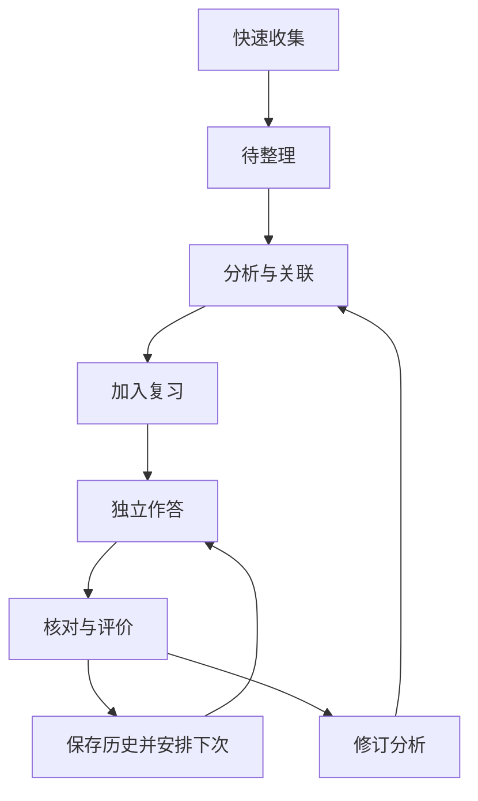
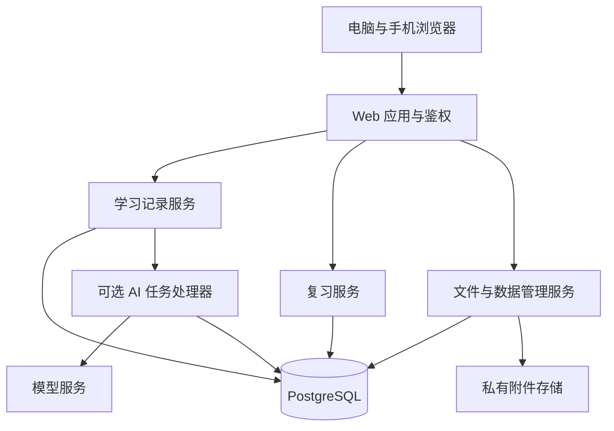

# 研习本：考研错题与英语学习系统

## 软件需求与设计说明书

| 文档属性 | 内容 |
| --- | --- |
| 文档编号 | MN-SD-001 |
| 文档版本 | 1.0 |
| 编制日期 | 2026-10-21 |
| 文档状态 | 设计初稿，待需求评审；不代表功能已实现 |
| 项目名称 | 研习本（暂定名） |
| 主要用户 | 备考研究生入学考试的个人学习者 |
| 文档用途 | 需求评审、架构评审、原型制作、编码实施、测试和验收 |
| 版本范围 | MVP（最小可用版本）及后续迭代边界 |

> 本文按照“项目定义→需求分析→总体设计→详细设计→数据与接口设计→测试验收→部署维护→变更管理”的软件工程流程组织，将需求规格和软件设计合并为一个 Markdown 交付件。本文未宣称满足某项特定国家标准或行业认证；如课程、单位另有模板，应按其要求拆分或调整。文中性能、容量、备份和复习参数为设计目标，尚未通过实现或测试验证。

## 目录

1. [项目定义与范围](#1-项目定义与范围)
2. [软件开发流程与评审](#2-软件开发流程与评审)
3. [需求分析](#3-需求分析)
4. [业务流程与状态设计](#4-业务流程与状态设计)
5. [总体架构设计](#5-总体架构设计)
6. [页面与交互设计](#6-页面与交互设计)
7. [业务模块详细设计](#7-业务模块详细设计)
8. [数据库与存储设计](#8-数据库与存储设计)
9. [接口设计](#9-接口设计)
10. [安全与隐私设计](#10-安全与隐私设计)
11. [非功能设计](#11-非功能设计)
12. [测试与验收方案](#12-测试与验收方案)
13. [开发实施与配置管理](#13-开发实施与配置管理)
14. [部署、备份与维护](#14-部署备份与维护)
15. [风险、待确认事项与变更管理](#15-风险待确认事项与变更管理)
16. [需求追踪矩阵](#16-需求追踪矩阵)
17. [附录](#17-附录)

## 1. 项目定义与范围

### 1.1 项目背景

用户准备 2028 考研，需要长期积累高等数学错题、408 专业课问题、英语生词与长难句。散落在纸面、相册和聊天中的材料不易查找，也难以判断复习效果。本项目将原始材料、个人分析、知识关联和复习记录集中管理。

### 1.2 产品目标

- 降低收集成本：拍照、截图或粘贴后即可保存，分析允许稍后补充。
- 提高整理质量：保留原思路，指出具体错误，形成下一次可执行的判断方法。
- 支持主动检验：先作答，再看解析，记录独立完成情况。
- 支持归纳迁移：将错题、生词、句子与知识点关联。
- 保障长期可用：跨设备访问，支持完整备份、恢复和可读导出。

### 1.3 使用假设

| 项目 | 设计假设 |
| --- | --- |
| 用户规模 | 首期单人私人使用；数据模型保留用户隔离能力 |
| 终端 | 电脑整理与复习；手机拍照收集与轻量复习 |
| 网络 | 首期以联网使用为主；不承诺完整离线和后台同步 |
| 科目 | 高等数学、408、英语；数学分类允许后续扩展 |
| 部署 | 一个应用实例、一个数据库、持久附件存储 |
| 智能分析 | 第二阶段可选能力；不作为基础学习流程的依赖 |
| 日期 | 每个账号有时区设置，默认 Asia/Shanghai |

### 1.4 首期范围与排除项

| 范围 | 功能 |
| --- | --- |
| MVP 必须交付 | 私人登录、快速收集、四类模板、编辑与自动保存、分类与搜索、基础关联、复习队列与历史、回收站、完整备份恢复、Markdown 导出 |
| 第二阶段 | AI 图片识别与分析、独立知识总结卡片、多提示复习、薄弱点统计增强 |
| 后续评估 | 更复杂的间隔调度、离线使用、词语发音、交互式句法标注、批量导入 |
| 首期不包含 | 社区、收费系统、公共题库抓取、教师班级管理、原生手机应用、自动判断所有学科答案正确性 |

### 1.5 成功标准

验收时，用户可从手机上传真实材料，在电脑整理，隔日从复习队列完成检验，查看历史，并在空白测试环境恢复包含附件的数据。是否提高考试成绩需要长期观察，不作为软件验收时的保证。

## 2. 软件开发流程与评审

### 2.1 阶段与交付物

| 阶段 | 输入 | 活动 | 输出 | 通过条件 |
| --- | --- | --- | --- | --- |
| 项目定义 | 学习场景 | 明确目标、范围、约束 | 项目范围与假设 | 确认首期边界 |
| 需求分析 | 真实材料、使用习惯 | 拆解用例和业务规则 | 需求清单、用例、验收条件 | 需求可验证且无关键矛盾 |
| 总体设计 | 需求基线 | 划分模块、技术选型 | 架构、部署和数据模型 | 核心流程可实现 |
| 详细设计 | 总体设计 | 细化页面、状态、接口与算法 | 原型、字段定义、接口契约 | 开发无需猜测关键规则 |
| 实现 | 设计与任务清单 | 编码、迁移、自动化检查 | 可运行版本 | 核心测试通过 |
| 系统测试 | 候选版本 | 功能、安全、恢复与兼容测试 | 测试记录和缺陷清单 | 无阻塞缺陷 |
| 验收发布 | 测试版本 | 真实材料走查、部署演练 | 发布版本和运行说明 | 满足验收清单 |
| 维护迭代 | 日志和反馈 | 修复、评估、变更 | 新版本、迁移记录 | 兼容已有数据 |

### 2.2 评审方式

个人项目可由同一开发者承担多个角色，但需要分别完成用户视角、实现视角和测试视角的检查。需求评审先用每类至少 3 份真实材料走查；架构评审重点检查保存、复习、权限和恢复；发布评审确认测试证据与回滚方案。

本文件是设计起点，低保真原型、最终 OpenAPI 契约、可执行迁移和运行手册在对应阶段补齐。本文中的示例数据不是已存在的数据库记录。

## 3. 需求分析

### 3.1 用户与角色

| 角色 | 权限 |
| --- | --- |
| 未登录访客 | 访问登录页和必要的静态资源 |
| 记录所有者 | 管理自己的记录、附件、知识点、复习、备份与设置 |
| 运维人员 | 管理运行环境、备份与发布；不设计业务后台浏览私人内容 |

首期不开放公开注册。初始账号通过受控初始化流程创建。

### 3.2 功能需求

优先级：P0 为 MVP 必须完成；P1 为第二阶段；P2 为候选功能。

| 编号 | 功能需求 | 优先级 | 核心验收条件 |
| --- | --- | --- | --- |
| FR-001 | 登录与退出 | P0 | 未登录不能读取私人接口，退出后会话失效 |
| FR-002 | 快速收集 | P0 | 选择类型并提供文字或有效附件后可保存 |
| FR-003 | 四类结构化模板 | P0 | 不同类型显示专属字段，能保存并回读 |
| FR-004 | 自动保存与冲突检测 | P0 | 显示保存状态；旧版本写入返回冲突且不覆盖 |
| FR-005 | 公式、代码、图片 | P0 | 可显示公式和代码，附件失败不会伪装成成功 |
| FR-006 | 分类与知识点 | P0 | 支持科目层级、知识点多选和错因筛选 |
| FR-007 | 搜索与列表筛选 | P0 | 可组合关键词、科目、类型、整理状态和知识点 |
| FR-008 | 记录关联 | P0 | 可关联同用户记录，删除后不产生可访问的悬空链接 |
| FR-009 | 计划复习与主动复习 | P0 | 展示到期队列；支持自选内容练习 |
| FR-010 | 复习提交与调度 | P0 | 重复请求只记录一次，历史与计划一致 |
| FR-011 | 回收站与恢复 | P0 | 软删除隐藏内容，恢复后原附件与历史仍在 |
| FR-012 | 完整备份与恢复 | P0 | 在隔离环境恢复数据库内容、附件、关联和历史 |
| FR-013 | 可读导出 | P0 | Markdown 与相对附件路径可独立阅读 |
| FR-014 | 今日学习页 | P0 | 到期和待整理数量与相应列表一致 |
| FR-015 | 账号与复习设置 | P0 | 可修改时区、每日展示上限和调度参数 |
| FR-016 | AI 分析草稿 | P1 | 用户确认前不写入正式分析字段 |
| FR-017 | 独立总结卡片 | P1 | 可关联多条材料并单独复习 |
| FR-018 | 薄弱点统计 | P1 | 显示样本量、时间范围和统计口径 |
| FR-019 | 离线与同步 | P2 | 另行定义冲突合并、容量与失败恢复 |

### 3.3 主要用例

#### UC-01 快速收集

- 参与者：已登录用户。
- 前置条件：会话有效，拥有可输入文字或上传的材料。
- 主流程：选类型→输入文字或上传图片→保存→系统建立待整理记录。
- 成功后置条件：记录有唯一 ID，已完成的附件与记录建立关联。
- 异常：上传失败时允许重试；文字记录可独立保存；只有失败附件且无文字时不得显示收集成功。

#### UC-02 整理分析

- 前置条件：记录存在且归当前用户所有。
- 主流程：查看原文→补充专属字段→选择知识点与错因→保存→可选标记已整理并加入复习。
- 后置条件：内容版本递增，历史版本保留，复习项按规则建立。
- 异常：版本冲突时保留本次输入，显示最新内容供比较；不自动覆盖。

#### UC-03 完成计划复习

- 前置条件：存在有效复习项。
- 主流程：查看题面→作答→可选查看提示→展开解析→评价→提交。
- 后置条件：只新增一条复习历史，并更新该复习项的下一次日期。
- 异常：断网或重复提交使用相同请求标识重试；提交前检测调度版本冲突。

#### UC-04 主动练习

- 主流程：用户筛选记录→开始练习→作答和评价→保存练习历史。
- 规则：首期主动练习不改变既有到期日期，页面明确说明；需要影响计划时使用计划复习入口。

#### UC-05 查找并归纳

- 主流程：组合筛选→打开相关记录→建立关系或补充总结。
- 异常：无结果时显示当前条件，可逐项清除；不自动修改用户筛选。

#### UC-06 备份与恢复

- 主流程：生成备份→下载→在隔离环境校验→导入→检查附件与关联→确认切换。
- 规则：恢复属于受控维护操作，MVP 不提供一键覆盖正在使用的正式数据库。

### 3.4 非功能需求

| 编号 | 类别 | 设计目标与验证方法 |
| --- | --- | --- |
| NFR-001 | 易用性 | 熟悉操作后，已有照片的快速收集以 3 个主要步骤完成；通过原型走查验证 |
| NFR-002 | 性能 | 在第 11 节固定环境中，普通查询 API P95≤800ms；图片上传和 AI 不计入 |
| NFR-003 | 数据完整性 | 已提交的复习不能丢历史或重复调度；用事务和并发测试验证 |
| NFR-004 | 安全 | 私人数据与附件必须鉴权；用两个测试账号验证横向越权 |
| NFR-005 | 可恢复性 | 目标 RPO≤24h、RTO≤4h；通过恢复演练验证 |
| NFR-006 | 兼容性 | 覆盖发布时的主流 Chromium 浏览器、Android Chrome 与 iOS Safari |
| NFR-007 | 可维护性 | 业务规则独立于页面；类型检查、迁移和关键测试纳入发布检查 |
| NFR-008 | 可迁移性 | 备份携带格式版本；导出无在线服务依赖；异版本恢复有明确拒绝或转换 |
| NFR-009 | 可访问性 | 主要操作支持键盘、表单标签、可见焦点和文字错误提示 |

## 4. 业务流程与状态设计

### 4.1 学习业务流程



### 4.2 状态分离

| 状态维度 | 状态值 | 规则 |
| --- | --- | --- |
| 整理状态 | INBOX、ORGANIZED | 由用户确认，已整理可退回待整理 |
| 复习阶段 | NEW、LEARNING、MAINTENANCE、PAUSED | 来自复习项，暂停保留历史与间隔 |
| 删除状态 | ACTIVE、DELETED | 用 deleted_at 表示，不混入整理状态 |
| 附件状态 | PENDING、READY、FAILED | 只有 READY 可作为有效题面 |
| AI 任务 | QUEUED、RUNNING、SUCCEEDED、FAILED、CANCELLED | 独立于记录保存状态 |

“长期巩固”表示进入较长复习间隔，不代表永久掌握。“已整理”不自动代表已加入复习。

### 4.3 核心业务规则

| 编号 | 规则 |
| --- | --- |
| BR-001 | 记录至少含有效文字或一个 READY 附件 |
| BR-002 | 已关联专属详情的记录类型不直接切换；MVP 通过复制为新类型完成转换 |
| BR-003 | 题面与答案分区，复习初始隐藏答案 |
| BR-004 | 查看、跳过、打开页面都不生成成功复习历史 |
| BR-005 | 相同请求标识不能重复产生写入副作用 |
| BR-006 | 知识点所属科目须与记录兼容，标签可跨科目 |
| BR-007 | 软删除记录不进入搜索和复习；恢复后复习默认暂停，由用户恢复计划 |
| BR-008 | 自动保存只更新草稿内容，不隐式完成整理或加入复习 |
| BR-009 | AI 原始输出不能覆盖题面、原解答或已确认总结 |
| BR-010 | 词条重复只提示；用户可以选择追加语境或保留独立词条 |

## 5. 总体架构设计

### 5.1 架构选择

采用模块化单体应用，前端与服务端在同一代码仓库中开发。系统规模较小，模块化单体便于统一发布与调试；通过业务模块边界保留后续拆分能力。



### 5.2 技术选型与决策

| 决策 | 初始方案 | 理由与约束 |
| --- | --- | --- |
| ADR-001 | Next.js、React、TypeScript | 页面和服务端统一工程；版本在编码前核实并锁定 |
| ADR-002 | PostgreSQL、Prisma | 关系数据、事务、查询与迁移；正式结构以迁移文件为准 |
| ADR-003 | Markdown 编辑与安全预览 | 保存可迁移源码，支持代码块；数学表达使用 KaTeX 等公式渲染组件 |
| ADR-004 | 附件独立存储 | MVP 可使用持久磁盘；访问必须经过鉴权；后续替换对象存储 |
| ADR-005 | 成熟认证组件与服务端会话 | 不自行设计密码学或令牌算法；初始化阶段固定具体方案 |
| ADR-006 | 数据库任务表与后台处理器 | 第二阶段 AI 和较大导出使用；首期不引入额外队列基础设施 |
| ADR-007 | 固定日历间隔的可配置调度 | 规则透明、易验证；后续算法可替换且保留旧历史 |

这里的选型属于设计建议，不指定未经核验的软件版本。编辑器、认证组件和 AI 服务商的最终选择是实施前任务。

### 5.3 模块依赖规则

- 页面组件不得直接操作数据库。
- 请求入口负责鉴权与参数校验，业务服务负责规则，仓储层负责持久化。
- 所有写入路径，包括服务端函数和接口，都调用相同业务服务。
- 调度算法采用纯函数：输入当前计划、评价与日期，输出新计划，不直接发起网络或数据库操作。
- AI 服务通过适配接口调用，业务不依赖某个厂商专有响应格式。

### 5.4 建议代码结构

```text
src/
  app/                    页面、布局与请求入口
  components/             通用界面组件
  modules/
    auth/                 会话与身份
    entries/              四类记录、版本与关联
    taxonomy/             科目、知识点、标签
    review/               队列、调度与历史
    attachments/          上传、鉴权访问与清理
    data-management/      导出、备份与恢复校验
    ai/                   第二阶段任务和模型适配
  lib/                    数据库连接、错误、日志与配置
prisma/                   数据模型与迁移
tests/                    关键规则、接口与端到端测试
docs/                     需求、设计、决策和运行说明
scripts/                  初始化、备份与恢复命令
```

## 6. 页面与交互设计

### 6.1 导航与路由

| 页面 | 路由示例 | 主要区域 |
| --- | --- | --- |
| 登录 | /login | 登录表单和错误提示 |
| 今日学习 | /today | 到期复习、待整理、最近继续项 |
| 收集箱 | /inbox | 缩略图、类型、来源和整理入口 |
| 资料库 | /library | 科目树、组合筛选、搜索、分页列表 |
| 新建 | /entries/new | 快速模式与完整模板 |
| 详情 | /entries/:id | 原材料、个人分析、解析、关联、历史 |
| 编辑 | /entries/:id/edit | 对应类型表单与实时预览 |
| 复习 | /review | 筛选、队列、题面、提示、评价 |
| 知识点 | /knowledge/:id | 节点说明、相关记录与练习入口 |
| 回收站 | /trash | 软删除记录和恢复操作 |
| 设置 | /settings | 时区、复习、数据与账号 |

### 6.2 布局

- 桌面端：左侧导航、主内容区；编辑和详情支持原图与分析左右对照。
- 手机端：底部导航为今日、资料库、收集、复习；长表单分区展开。
- 公式或代码超宽时局部滚动，页面整体不横向溢出。
- 常用操作有文字说明，不只依赖颜色或图标。

### 6.3 关键交互约定

| 场景 | 交互约定 |
| --- | --- |
| 自动保存 | 停止输入约 1.5 秒后提交；显示保存中、已保存、失败和时间 |
| 离开页面 | 未保存时提示；首期不承诺关闭浏览器后找回未同步输入 |
| 多端冲突 | 返回最新版本与本地版本，用户比较后重试 |
| 图片上传 | 显示进度与失败状态，允许单文件重试 |
| 无搜索结果 | 保留条件，提供清除筛选按钮 |
| 复习展开解析 | 记录是否使用提示，随后由用户评价表现 |
| 误操作 | 普通删除进入回收站；永久删除需明确确认 |
| 弱网 | 明确区分已保存至服务端与仅保留在当前页面 |

## 7. 业务模块详细设计

### 7.1 四类记录模板

#### 7.1.1 数学 MATH

| 字段 | 类型 | 必填与约束 |
| --- | --- | --- |
| problem_md | Markdown | 与有效题图至少有一项 |
| original_work_md | Markdown | 可选，记录原解法 |
| error_step_md | Markdown | 可选，定位错误步骤 |
| error_categories | 枚举关联 | 概念、条件、方法、计算、审题、表达；可多选 |
| solution_md | Markdown | 可选，允许多解 |
| applicability_md | Markdown | 方法适用条件 |
| decision_rule_md | Markdown | 题目特征到方法选择的判断 |
| takeaway_md | Markdown | 可复用总结 |

允许收藏未做错的典型题。数学分类首期启用高数，数据结构保留线代和概率论扩展。

#### 7.1.2 408 CS

| 字段 | 类型 | 说明 |
| --- | --- | --- |
| subtype | 枚举 | QUESTION 或 CONCEPT |
| course | 枚举 | 数据结构、组成原理、操作系统、网络 |
| question_md | Markdown | 题目或概念疑问 |
| options_json | 结构化数组 | 客观题选项，按子类型可选 |
| my_answer_md | Markdown | 我的答案或原理解 |
| reference_answer_md | Markdown | 参考答案 |
| principle_md | Markdown | 正确原理与推理 |
| comparison_md | Markdown | 易混概念 |
| boundary_md | Markdown | 条件、边界、反例 |
| self_explanation_md | Markdown | 自己的解释 |

#### 7.1.3 生词 VOCABULARY

词条详情保存 lemma、原词形、词性、个人总结。语境使用独立的 vocabulary_contexts 表，保存原句、语境词义、出处、搭配和关联长难句 ID，支持同词多语境。音标、音频不列入 MVP 必填项。

去重以归一化 lemma、词性和用户为提示依据，不建立强制唯一约束，允许不同用法独立学习。

#### 7.1.4 长难句 SENTENCE

| 字段 | 说明 |
| --- | --- |
| original_text | 原句，整理时不可为空 |
| context_md | 必要上下文 |
| initial_translation_md | 初次理解 |
| main_clause_md | 主干 |
| clause_analysis_md | 从句、非谓语、插入语 |
| reference_logic_md | 指代与逻辑关系 |
| reference_translation_md | 参考译文 |
| difficulty_md | 具体理解障碍 |

MVP 使用文字分区标注；精确字符区间高亮另行设计，避免修改原句后标注错位。

### 7.2 分类、搜索与关联

- 科目与知识点：树状结构，禁止循环引用；归档节点不影响已有记录回显。
- 标签：用户自定义、可跨科目；同用户内归一化名称唯一。
- 错因：预设枚举，与标签分开，支持后续统计。
- 关系：SIMILAR、SUPPORTS、CONTRASTS、CONTAINS_VOCABULARY 等受控类型。
- 搜索范围：标题、原文、个人总结、专属分析字段与来源文字；首期不搜索未识别图片内容。
- MVP 使用数据库参数化的文本包含查询；中文不依赖空格分词。大小写归一化，支持分页；数据增长后再评估 trigram 等索引方案。
- 组合筛选之间为 AND；同一多选条件内部为 OR；列表明确展示当前条件。

### 7.3 附件生命周期

1. 验证用户、文件大小和实际媒体类型。
2. 分配随机存储键，创建 PENDING 记录并写入私有区域。
3. 完成校验后标记 READY，保存字节数、摘要与媒体信息。
4. 记录保存时确认附件属于当前用户且已 READY。
5. 失败文件标记 FAILED；未关联的临时文件在 24 小时后清理。
6. 软删除不删除文件；永久删除时确认无其他引用后再清理。

数据库事务无法回滚文件写入，因此通过状态和定期清理处理孤立文件。用户上传的文件名仅作显示，不作为磁盘路径。

### 7.4 复习调度

MVP 每条记录默认一个复习项，提示类型由记录类型确定。复习项保留 prompt_type 字段，为后续同记录多提示预留能力。

评价：AGAIN（不会）、HARD（困难）、GOOD（掌握）、EASY（熟练）。查看关键提示后不允许选择 EASY；用户仍可选择 GOOD 或更低评价。

初始规则使用间隔阶梯 S=[1,3,7,14,30,60] 天，首次 stage_index=-1。以下是待试用调整的产品规则，不宣称为经验证的记忆模型：

| 评价 | 新阶段 | 下次日期 |
| --- | --- | --- |
| AGAIN | 0，连续成功次数清零 | 本次用户日期 +1 天 |
| HARD | max(0,原阶段-1) | 本次用户日期 +S[新阶段] |
| GOOD | min(5,原阶段+1) | 本次用户日期 +S[新阶段] |
| EASY | min(5,原阶段+2) | 本次用户日期 +S[新阶段] |

新加入的记录默认当日到期，首次复习后进入上述规则。连续 3 次 GOOD/EASY 且阶段≥3 时显示 MAINTENANCE；任何 AGAIN/HARD 返回 LEARNING。PAUSED 不参与队列，恢复时保留原到期日并提示可能逾期。

日期与计数规则：

- 时间戳使用 UTC；到期计划使用用户本地日历日期 due_on。
- 用户时区改变不批量平移已有 due_on，下一次提交使用新时区计算。
- 每日展示上限默认 20，可配置；剩余任务仍保留并显示数量。
- 排序：到期日期升序、近期失败优先、ID 稳定排序。
- 同一复习项同一用户日期仅接受一次计划调度；后续重做记录为主动练习，不延长计划。
- 跨午夜提交按服务器接收时转换出的用户日期计算，并在响应中返回实际日期。
- 主动练习保存历史，不改变计划。

完成计划复习的事务：

1. 根据用户和请求幂等键查询已有结果；命中则返回同一结果。
2. 锁定复习项，验证 owner、未删除、未暂停和 expected_version。
3. 检查该项当天是否已经有计划提交。
4. 用纯函数计算下一计划。
5. 写 review_logs、更新 review_items 与版本、存幂等结果。
6. 一并提交；失败全部回滚。

### 7.5 版本、删除与恢复

自动保存使用乐观并发控制，PATCH 携带 expected_version。成功后 version+1；不匹配返回 409。当前内容每次正常保存更新；历史快照最多每 5 分钟自动生成一次，手动保存、完成整理、应用 AI 与删除前强制生成，减少自动保存产生的冗余。

软删除保留 30 天。MVP 到期后不自动永久销毁，由维护流程或用户明确清理。永久删除只在无活动写入后执行，并保留最少审计信息，不保留私人正文。

### 7.6 AI 模块（第二阶段）

支持 OCR、数学错因建议、408 概念解释、生词语境解释、长难句拆解和跨记录归纳。每个任务保存输入版本、任务类型、模型标识、提示模板版本与结果草稿。

| 规则 | 行为 |
| --- | --- |
| 输入最小化 | 只发送用户选择的内容，不自动发送全部资料库 |
| 输出校验 | 校验结构、长度和允许字段，再展示 |
| 用户确认 | 将选定结果写入指定字段，执行普通版本检查 |
| 内容已改变 | 提示分析基于旧版本，不自动应用 |
| 故障 | 超时、取消或格式错误只影响任务，不影响原记录 |
| 费用 | 限制调用频率、单次输入和每日预算；显示调用状态 |
| 可追溯 | 综合结论列出实际输入记录 ID 和引用片段 |

任务状态以数据库为准，处理器通过租约领取任务；失败最多自动重试 2 次，避免无限重试。AI 内容始终作为待核对建议。

## 8. 数据库与存储设计

### 8.1 公共约定

- 主键为 UUID；UTC 时间戳使用 timestamptz；本地复习日期使用 date。
- 公共表包含 created_at、updated_at；需要恢复的实体包含 deleted_at。
- 用户输入字段在服务端校验；数据库外键、唯一与检查约束承担最终完整性保证。
- 所有业务记录归属用户；跨表关系通过复合外键或同事务校验确保 owner 一致。
- Markdown 是可迁移内容源码；业务分类、日期和状态不放进自由文本。

### 8.2 核心表

| 表 | 关键字段与约束 |
| --- | --- |
| users | id、timezone、display_name；认证凭证由选定认证方案管理 |
| entries | id、user_id、type、title、subject_id、source_json、summary_md、organize_status、version、deleted_at |
| math_details | entry_id PK/FK、题目、原解、错步、解法、条件、判断、总结 |
| cs_details | entry_id PK/FK、subtype、course、题干、选项、答案、原理、边界 |
| vocabulary_details | entry_id PK/FK、lemma、surface_form、part_of_speech |
| vocabulary_contexts | id、user_id、entry_id、sentence_text、meaning_md、source_json、sentence_entry_id |
| sentence_details | entry_id PK/FK、original_text、上下文、初译、主干、结构、译文、难点 |
| subjects | id、code UNIQUE、name；预置数学、408 子科目和英语 |
| knowledge_nodes | id、user_id、subject_id、parent_id、name、description_md、archived_at |
| entry_knowledge | entry_id、knowledge_id 复合主键，包含 owner 校验 |
| tags / entry_tags | 标签与多对多关联；标签归一化名称在用户内唯一 |
| error_categories / entry_errors | 错因字典及多对多关联 |
| attachments | id、user_id、storage_key UNIQUE、original_name、mime、size、sha256、status |
| entry_attachments | entry_id、attachment_id、role、sort_order；role 区分题面和答案 |
| entry_relations | user_id、from_id、to_id、relation_type；禁止自关联，三元组唯一 |
| review_items | id、user_id、entry_id、prompt_type、stage、stage_index、success_streak、due_on、version |
| review_logs | id、user_id、review_item_id、mode、rating、hint_used、answer_md、reviewed_at、review_local_date、algorithm_version、before_json、after_json |
| entry_revisions | id、entry_id、version、snapshot_json、reason、created_at |
| idempotency_keys | user_id、scope、key、request_hash、response_json、expires_at；前三列唯一 |
| export_jobs | id、user_id、type、status、storage_key、expires_at |
| ai_jobs | P1：id、user_id、entry_id、input_version、task_type、status、lease_until、result_json、error_code |

source_json 固定允许 book_title、year、page、question_no、url 等键。采用 JSON 的内容必须有服务端 schema 和备份格式版本，不作为任意无约束数据容器。

### 8.3 关系约束

- entries 与四类专属详情按 type 保持恰当的一对一；在业务事务内验证，必要时增加数据库触发器。
- 用户词条有多个语境；语境可关联一条长难句。
- 记录与知识点、标签、附件为多对多关系。
- 首期每个 entry_id + prompt_type 只有一个复习项。
- review_logs 对计划模式建立“review_item_id + review_local_date”部分唯一约束，阻止当天重复调度。
- 同一幂等键配不同 request_hash 返回冲突，不复用错误响应。
- 删除知识点优先归档；永久删除时要求先处理子节点和关联。

### 8.4 索引

| 索引 | 查询用途 |
| --- | --- |
| entries(user_id, deleted_at, updated_at, id) | 用户资料库与稳定排序 |
| entries(user_id, type, organize_status) | 类型和整理状态筛选 |
| review_items(user_id, stage, due_on, id) | 到期队列 |
| review_logs(user_id, reviewed_at) | 历史与时间段统计 |
| entry_knowledge(knowledge_id, entry_id) | 知识点反查 |
| vocabulary_details(lemma) | 去重提示，结合 owner 查询 |
| attachments(user_id, status, created_at) | 上传与孤立文件清理 |

复杂搜索索引根据 EXPLAIN 和压测结果增加，不假设普通 B-tree 能加速所有包含查询。

### 8.5 容量假设

首期验证数据集为 10,000 条记录、100,000 条复习历史、20,000 个知识与标签关系。附件按 10,000 张、平均 0.5MB 估算约 5GB，实际取决于照片大小。部署规划另计缩略图、数据库、版本与多代备份，不能只按原图容量配置磁盘。

## 9. 接口设计

### 9.1 通用契约

- 前缀 /api/v1；JSON UTF-8；UUID 作为 ID。
- Cookie 会话鉴权；写操作验证来源并采用认证方案要求的 CSRF 防护。
- 成功格式：{"data":...,"meta":{"requestId":"..."}}。
- 失败格式：{"error":{"code":"...","message":"...","fields":{}},"meta":{"requestId":"..."}}。
- 列表 limit 默认 20、最大 100；使用与筛选、排序绑定的游标。
- 幂等键通过 Idempotency-Key 传入；复习、AI、导出强制要求；建议保留至少 7 天。
- UUID、状态值、长度、关联权限均在服务端验证，拒绝未声明的可写字段。

### 9.2 接口清单

| 方法 | 路径 | 用途 | 主要规则 |
| --- | --- | --- | --- |
| POST | /auth/login | 登录 | 限速、统一失败提示 |
| POST | /auth/logout | 退出 | 使当前会话失效 |
| GET | /entries | 查询记录 | 组合过滤和游标 |
| POST | /entries | 创建记录 | 文字或有效附件至少一项 |
| GET | /entries/{id} | 详情 | 所有权检查 |
| PATCH | /entries/{id} | 修改 | expectedVersion 必填 |
| DELETE | /entries/{id} | 软删除 | 同步暂停复习 |
| POST | /entries/{id}/restore | 恢复 | 原计划保持暂停 |
| GET | /entries/{id}/revisions | 版本历史 | 不返回其他用户数据 |
| POST | /attachments | 上传 | multipart、媒体验证 |
| GET | /attachments/{id}/content | 私有下载 | 鉴权、正确响应头 |
| POST | /entries/{id}/relations | 关联记录 | 同用户、去重 |
| GET/POST | /knowledge-nodes | 查询或创建知识点 | 校验层级和科目 |
| GET | /reviews/queue | 到期队列 | 使用账号时区 |
| POST | /review-items | 加入复习 | 防重复创建 |
| PATCH | /review-items/{id} | 暂停或恢复 | 版本检查 |
| POST | /review-items/{id}/attempts | 提交评价 | 事务、幂等、版本检查 |
| GET | /reviews/history | 复习历史 | 区分计划和主动练习 |
| GET/PATCH | /settings | 读取或修改设置 | 参数范围检查 |
| POST | /exports | 创建导出 | 二次验证会话、幂等 |
| GET | /exports/{id} | 查询或下载 | 私有、有效期限制 |
| POST/GET | /ai/jobs[/{id}] | P1 分析任务 | 预算、版本、状态 |

完整备份和恢复由受控运维命令完成；普通网页导出只访问当前用户数据。若后续增加网页恢复功能，需另行设计隔离导入和权限。

### 9.3 修改记录示例

```json
{
  "expectedVersion": 12,
  "title": "极限题：替换前检查主要项",
  "summaryMd": "先判断运算结构和主要项，再选择替换或展开。",
  "details": {
    "decisionRuleMd": "检查加减项是否发生抵消。"
  },
  "knowledgeIds": ["f7f7e606-d4a0-450b-8e0d-81048d853990"]
}
```

details 采用当前记录类型对应的 schema。PATCH 合并规则：省略字段表示不改；显式 null 只清空允许为空的字段；数组出现时整体替换，防止客户端误解。

### 9.4 提交复习示例

请求头：Idempotency-Key: review-attempt-example-001。

```json
{
  "expectedVersion": 4,
  "mode": "SCHEDULED",
  "rating": "GOOD",
  "hintUsed": false,
  "answerMd": "已独立重做并核对适用条件。"
}
```

返回包含 attemptId、reviewLocalDate、nextDueOn、newVersion、algorithmVersion。重复发送同一幂等键和同一请求返回原结果。

### 9.5 错误码

| HTTP | 业务错误码 | 客户端行为 |
| --- | --- | --- |
| 400 | VALIDATION_ERROR | 显示字段错误，保留输入 |
| 401 | UNAUTHENTICATED | 提示重新登录，尽量保留当前输入 |
| 404 | RESOURCE_NOT_FOUND | 缺失或无权访问统一处理 |
| 409 | VERSION_CONFLICT | 显示版本比较 |
| 409 | IDEMPOTENCY_CONFLICT | 更正请求标识或恢复原请求 |
| 409 | ALREADY_REVIEWED_TODAY | 展示当天结果或转主动练习 |
| 413/415 | FILE_TOO_LARGE / UNSUPPORTED_MEDIA | 说明文件限制 |
| 429 | RATE_LIMITED | 展示可重试时间 |
| 500/503 | INTERNAL_ERROR / SERVICE_UNAVAILABLE | 给出请求编号，支持安全重试 |

## 10. 安全与隐私设计

| 风险 | 控制措施 | 验证 |
| --- | --- | --- |
| 横向越权 | 全链路 owner 检查，附件同样鉴权 | 双账号替换 ID 测试 |
| 会话泄露 | HTTPS、HttpOnly、Secure、合理 SameSite、退出失效 | 检查 Cookie 和会话 |
| 注入 | 参数化查询、输入 schema、禁止用户拼接 SQL | 恶意输入测试 |
| XSS | Markdown 安全渲染、禁用原始 HTML、公式组件安全选项、CSP | 注入脚本测试 |
| 危险上传 | MIME 与文件头检查、大小限制、随机键；首期不接受 SVG/HTML | 伪装文件测试 |
| 路径穿越 | 不使用原文件名构造路径，校验归档路径 | 上传与恢复恶意路径测试 |
| 账号暴力尝试 | 登录限速、统一失败响应 | 高频失败测试 |
| 密钥泄露 | 服务端环境配置、忽略本地密钥文件、日志脱敏 | 仓库与日志检查 |
| AI 数据外发 | 用户主动触发、说明所选数据、最小输入 | 检查实际请求范围 |

首期默认仅接受 JPEG、PNG、WebP 图片，每张≤10MiB，每条最多 10 张。其他格式需新增校验、预览和兼容测试后启用。不得为识别来源链接而自动抓取任意 URL，避免引入不必要的服务端请求风险。

备份中可能包含认证和私人信息，应限制读写权限，异地备份使用加密和独立密钥管理。备份下载后不生成公开永久链接。

## 11. 非功能设计

### 11.1 性能验证环境

暂定基准：2 vCPU、4GB 内存、SSD，单应用实例与同区域数据库，5 个并发测试会话，第 8.5 节结构化数据规模。API 性能测试区分应用处理时间与客户端网络时间，记录实际机器、版本、冷启动和样本量。

目标：普通查询 P95≤800ms，普通保存 P95≤1s；分页默认 20 条；上传与大导出单独测量。若环境资源不同，先调整目标再验收，不以未测数据宣称达标。

### 11.2 稳定性与观测

- 记录 requestId、错误码、耗时、任务状态、备份状态；不记录完整笔记和密钥。
- 外部服务设置超时，重试只作用于可安全重试操作。
- 提供存活与就绪检查；数据库或附件不可写时清晰失败。
- 磁盘容量、连续备份失败和任务长期卡住产生可见告警。
- AI 和导出处理器故障不阻塞普通记录编辑。

### 11.3 可维护性

依赖使用锁文件；升级先在开发或预发布环境验证。数据库迁移纳入版本控制，禁止直接修改正式库后遗忘迁移。领域规则与时钟可注入，便于验证跨日和时区边界。

## 12. 测试与验收方案

### 12.1 测试层次

| 层次 | 重点 |
| --- | --- |
| 单元测试 | 调度函数、日期计算、schema、状态转换 |
| 集成测试 | 事务、唯一约束、鉴权、版本冲突、附件生命周期 |
| 端到端 | 手机收集→电脑整理→复习→查历史 |
| 安全测试 | 越权、危险内容、伪造媒体、路径穿越 |
| 非功能测试 | 固定数据集查询、弱网、目标浏览器 |
| 恢复演练 | 空环境导入、摘要核对、业务抽样 |

### 12.2 关键测试用例

| 编号 | 场景 | 预期结果 |
| --- | --- | --- |
| TC-001 | 未登录查询或下载 | 不能访问私人数据 |
| TC-002 | 用户 A 请求 B 的记录与附件 | 返回统一不可访问响应 |
| TC-003 | 只有失败图片、没有文字时保存 | 明确失败，不出现空成功记录 |
| TC-004 | 四类字段保存后刷新 | 原文、公式、代码和专属字段一致 |
| TC-005 | 两客户端修改同一版本 | 一次成功，另一次 409 且保留输入 |
| TC-006 | 复习结果同键并发提交 | 一条历史、一次调度、同一响应 |
| TC-007 | 不同键同时提交同项 | 只有一个计划结果，另一个明确冲突 |
| TC-008 | 同一天再次计划复习 | 不继续延长间隔 |
| TC-009 | 主动练习 | 写练习历史，不改变到期日期 |
| TC-010 | 暂停、软删除与恢复 | 队列隐藏，恢复后暂停，历史存在 |
| TC-011 | 跨午夜与更改时区 | 遵守明确日期规则，无重复调度 |
| TC-012 | AI 失败或旧版本分析 | 原记录不变，不自动覆盖 |
| TC-013 | 备份含坏摘要或危险路径 | 导入前拒绝，现有数据不受影响 |
| TC-014 | 空环境恢复 | 记录、附件、关联和复习历史完整 |
| TC-015 | Markdown 离线导出 | 附件使用相对路径，无需登录可阅读 |
| TC-016 | 公式、中文、长句与窄屏 | 内容可读，错误不会使整页崩溃 |

### 12.3 MVP 验收清单

- [ ] 全部 P0 需求完成并对应测试记录。
- [ ] 每类至少 3 份用户真实材料完成收集与整理。
- [ ] 一次完整计划复习和一次主动练习结果正确。
- [ ] 未登录与双账号越权测试通过。
- [ ] 并发保存、重复复习和网络失败行为可解释。
- [ ] 完整备份在隔离空环境恢复成功。
- [ ] 附件摘要、记录数量、关联数量和历史数量核对一致。
- [ ] 手机上传、电脑编辑和主要浏览器走查通过。
- [ ] 无阻塞问题；剩余问题列出影响与处理计划。
- [ ] 运行配置、回滚、备份和恢复步骤已记录。

## 13. 开发实施与配置管理

### 13.1 工作分解

| 阶段 | 开发任务 | 交付证据 |
| --- | --- | --- |
| M0 需求基线 | 真实材料走查、确定未决项、低保真原型 | 需求清单与原型 |
| M1 基础工程 | 锁定依赖、认证、数据库、配置和日志 | 登录与保存最小记录 |
| M2 内容流程 | 四类模板、上传、草稿、版本、检索、关联 | 四类记录端到端演示 |
| M3 复习流程 | 纯调度函数、事务、队列、历史、设置 | 并发与日期测试结果 |
| M4 数据保障 | 回收站、导出、备份、恢复 | 恢复演练记录 |
| M5 发布验收 | 兼容性、安全、性能、部署和操作说明 | 验收清单与候选版本 |
| M6 智能分析 | AI 任务、草稿应用、预算、总结卡片 | 独立阶段验收 |

不在尚未验证工作量时承诺具体完成日期。M2 结束后即可进行真实试用，但必须明确其备份和复习功能是否已完成，不能当作正式验收版本。

### 13.2 每项开发任务模板

```markdown
任务编号：TASK-xxx
对应需求：FR-xxx
目标：用户完成什么操作
范围：涉及页面、服务、数据与迁移
依赖：前置任务
异常：失败、重复、冲突、无权限
验收：可观察的通过条件
验证：测试或人工走查方法
回滚：代码与数据如何恢复
```

### 13.3 版本控制与完成定义

- Git 管理源码、迁移、文档和依赖锁文件；不提交密钥、私人学习材料和备份。
- main 保持可发布，小功能分支完成后合并；发布使用标签。
- 发布检查至少包含类型检查、构建、关键规则测试和迁移演练。
- 完成定义：功能可用、异常处理完整、关键测试通过、相关文档更新、无已知数据破坏问题。
- 破坏性字段变化采用先扩展、迁移数据、切换代码、最后清理的顺序。

## 14. 部署、备份与维护

### 14.1 环境与部署拓扑

| 环境 | 数据要求 | 用途 |
| --- | --- | --- |
| 开发 | 合成或脱敏数据 | 编码和调试 |
| 预发布 | 独立数据库与附件目录 | 迁移、验收与恢复演练 |
| 正式 | 用户真实数据 | 日常学习 |

正式部署包含 HTTPS 入口、应用服务、数据库、持久附件目录和备份任务；第二阶段增加任务处理器。数据库不直接暴露到公网。附件和数据库不能只存放在部署替换后会丢失的临时文件系统。

### 14.2 发布与回滚

发布步骤：校验配置→确认最新有效备份→迁移演练→部署兼容代码与迁移→健康检查→登录、保存、上传和复习冒烟检查→标记版本。

代码可回滚到兼容旧版本；不可逆数据迁移不能靠回滚代码解决。涉及破坏性迁移必须提前制定恢复策略，并评估备份之后新写入的数据损失。

### 14.3 备份格式

用户可恢复备份包含 manifest.json、结构化 JSON 数据和附件；manifest 包含 schemaVersion、appVersion、exportedAt、表计数、文件大小与 SHA-256。Markdown 阅读导出另行生成，不作为完整恢复来源。

实例级运维备份还包含数据库一致性快照、附件清单和必要运行配置说明，不包含明文密钥。不同用户的数据导出不混入其他用户或认证凭证。

### 14.4 备份策略

- 初始目标每天一次，保留最近 7 份日备份与 4 份周备份。
- 备份存放在与正式磁盘故障域不同的位置，并限制访问。
- 首期采用短维护窗口暂停写入与文件清理，生成数据库快照和匹配附件清单；完成后恢复写入。
- 导出任务生成期间读取固定内容快照，附件按清单保留，避免边导出边删除导致缺失。
- 大规模数据下的在线一致性备份另行设计，不直接复制运行中的数据库目录。
- 每月至少一次恢复演练；未演练的备份不视为已验证可恢复。

RPO≤24 小时、RTO≤4 小时是初始目标，需要异地存储、告警和恢复演练共同支撑。

### 14.5 恢复步骤

1. 准备隔离环境，选择兼容应用版本。
2. 校验格式版本、表计数、摘要、归档路径与解压容量，拒绝损坏或不兼容包。
3. 导入数据库与附件；禁止直接覆盖当前正式环境。
4. 校验主外键、owner 一致性、附件可读性和历史记录。
5. 抽样打开四类记录并完成测试复习。
6. 经维护者明确确认后切换，保留旧环境以便回退。

## 15. 风险、待确认事项与变更管理

### 15.1 风险登记

| 风险 | 影响 | 应对 |
| --- | --- | --- |
| 功能范围持续扩大 | 开发挤占备考时间 | 先完成 P0，新增需求进入待办评估 |
| 录入过于繁琐 | 用户停止使用 | 快速收集与完整整理分开，真实材料试用 |
| AI 误判公式或知识 | 错误进入学习材料 | 原文独立、草稿确认、可追溯 |
| 图片存储耗尽 | 上传和备份失败 | 容量监控、限制、容量规划 |
| 复习积压 | 任务失控 | 分批展示、保留总量、允许暂停 |
| 备份与附件不一致 | 无法恢复 | 一致性窗口、清单摘要和演练 |
| 调度重复或时区错误 | 复习计划失真 | 幂等、唯一约束、事务与边界测试 |
| 依赖或外部服务变化 | 构建和功能中断 | 版本锁定、适配层、升级验证 |

### 15.2 待确认事项

以下事项不阻止原型制作，但须在对应实现阶段前确定。

| 编号 | 待确认事项 | 暂定选择 | 确认时点 |
| --- | --- | --- | --- |
| Q-01 | 是否始终私人使用 | 个人使用、关闭公开注册 | M1 前 |
| Q-02 | 实际访问地区、服务器与预算 | 未定 | 部署设计前 |
| Q-03 | 是否需要 PDF 题目材料 | MVP 仅图片与文字 | 上传开发前 |
| Q-04 | 是否首期纳入线代、概率论 | 保留扩展，先高数 | 原型评审 |
| Q-05 | 偏好 Markdown 还是更强所见即所得 | Markdown 加预览与公式模板 | 编辑器选型前 |
| Q-06 | 认证组件和账号恢复方式 | 成熟组件、受控初始化与维护恢复 | M1 前 |
| Q-07 | AI 服务商、预算与数据外发偏好 | 第二阶段独立确认 | M6 前 |
| Q-08 | 复习间隔与每日处理量 | 本文初始值，试用后调整 | M3 试用 |
| Q-09 | 异地备份位置与密钥保管 | 未定 | 正式上线前 |

### 15.3 需求变更

每次变更记录编号、原因、影响需求、页面、接口、数据库迁移、测试和排期。修改 P0 范围前先评估对数据兼容与备考使用的影响。重大决策写入 ADR；文档版本与发布版本分别管理。

## 16. 需求追踪矩阵

| 需求 | 设计位置 | 主要验证 |
| --- | --- | --- |
| FR-001 | 第 3、9、10 节 | TC-001、TC-002 |
| FR-002、FR-003 | 第 6、7.1 节 | TC-003、TC-004 |
| FR-004 | 第 6.3、7.5、9.3 节 | TC-005 |
| FR-005 | 第 7.1、7.3、10 节 | TC-003、TC-004、TC-016 |
| FR-006、FR-007、FR-008 | 第 7.2、8 节 | 分类过滤、关联权限与删除集成测试 |
| FR-009、FR-010 | 第 4、7.4、9.4 节 | TC-006 至 TC-011 |
| FR-011 | 第 7.5 节 | TC-010 |
| FR-012 | 第 14 节 | TC-013、TC-014 |
| FR-013 | 第 14.3 节 | TC-015 |
| FR-014、FR-015 | 第 6.1、7.4、9.2 节 | 首页计数与筛选一致、设置边界测试 |
| FR-016 | 第 7.6 节 | TC-012 |
| FR-017、FR-018 | 第 1.4、17.2 节 | 第二阶段另建详细设计与测试用例 |
| NFR-001、NFR-006、NFR-009 | 第 6、11 节 | 原型走查、键盘和终端兼容性 |
| NFR-002 | 第 8.5、11.1 节 | 固定环境与数据集性能测试 |
| NFR-003、NFR-004 | 第 7.4、8、10 节 | 并发事务与越权测试 |
| NFR-005、NFR-008 | 第 14 节 | 恢复计时、版本和摘要校验 |
| NFR-007 | 第 5.3、13 节 | 构建、迁移、关键测试与评审记录 |

## 17. 附录

### 17.1 概念定义

| 概念 | 定义 |
| --- | --- |
| 学习记录 | 一道题、一个疑问、一个词条或一个长难句 |
| 知识点 | 分类和关联节点，不直接代表掌握程度 |
| 复习项 | 一种提示方式对应的复习计划 |
| 复习历史 | 一次作答与评价的不可覆写事实记录 |
| 主动练习 | 用户主动选择材料练习，首期不改变计划 |
| 阅读导出 | 面向阅读的 Markdown 和附件 |
| 完整备份 | 可以恢复结构化数据、关系、附件和历史的数据包 |
| RPO | 可接受的数据丢失时间窗口 |
| RTO | 从故障到恢复使用的目标时间 |
| 幂等 | 相同请求重复执行不产生重复副作用 |
| 乐观并发控制 | 通过版本检查阻止旧内容覆盖新内容 |

### 17.2 第二阶段设计入口

独立总结卡片需要新增卡片类型、关联关系和复习提示；薄弱点统计应分别显示整理数量、复习样本量、近期失败数和提示使用情况。任何“掌握程度”描述都应说明观察窗口与样本，不以看似精确的百分比代替证据。第二阶段实施前另建需求与验收基线，不将预留字段等同于已完成功能。

### 17.3 参考资料

以下为选型相关的官方文档入口，具体命令与兼容版本以实施时核验结果为准。

- Next.js App Router：https://nextjs.org/docs/app
- Next.js 服务端能力：https://nextjs.org/docs/app/guides/backend-for-frontend
- Prisma 文档：https://www.prisma.io/docs
- PostgreSQL 文档：https://www.postgresql.org/docs/
- KaTeX 支持范围：https://katex.org/docs/support_table.html
- KaTeX 安全说明：https://katex.org/docs/security

### 17.4 文档修订记录

| 版本 | 日期 | 变更 |
| --- | --- | --- |
| 1.0 | 2026-10-21 | 初稿：项目定义、需求、架构、详细设计、数据、接口、测试、部署与追踪矩阵 |

